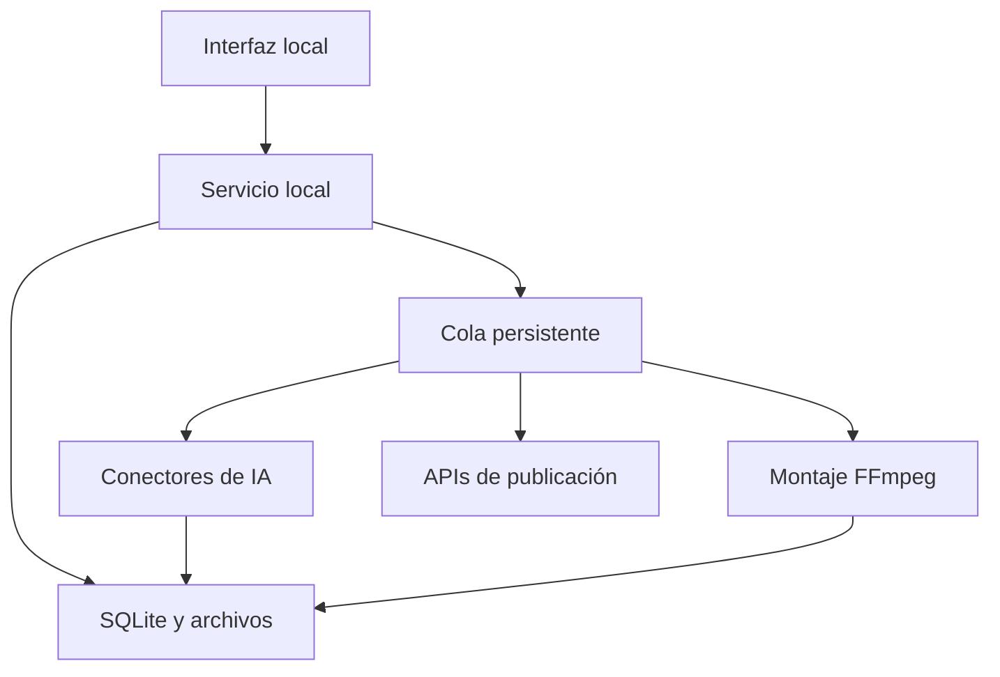

# Arquitectura de la primera versión

Se aplica la especificación acordada de forma modular. Esta versión es un piloto operativo, no una validación de volumen semanal.

## Componentes

| Archivo | Función |
|---|---|
| models.py | Entradas validadas, límites y opciones |
| db.py | Proyectos, revisiones, cola, archivos, publicaciones y ventanas de cuota |
| security.py | Vault sin texto plano, redacción y exclusión de instancias simultáneas |
| providers.py | OpenRouter, SDXL, Riva, Groq, OmniRoute y contrato de medios |
| pipeline.py | Planificación, producción, sincronización, calidad, render y materiales |
| media.py | FFmpeg, ASS/SRT, efectos sintetizados, portada y diagnóstico de archivos |
| publishing.py | Programación, consentimiento, APIs oficiales y resultados inciertos |
| server.py | Rutas locales, protección de sesión, importación y adaptación |
| web/ | Interfaz sin compilador de frontend ni servicios remotos |

## Revisión y recuperación

Una revisión de contenido cambia al editar guion, tiempos, recursos o ajustes. Se descarta la aprobación previa y se desvincula la exportación anterior; los archivos anteriores se conservan. La revisión humana final se guarda vinculada a la revisión de contenido actual.

Una sola tarea de producción activa por proyecto y un worker por aplicación limitan la concurrencia. Una exclusión de proceso sobre el directorio de datos evita dos workers manipulando la misma cola. SQLite usa transacciones, WAL y un reclamo atómico de tareas.

Una respuesta 429/503/502/504 provoca espera persistente, con Retry-After si existe. No se cambia de proveedor. Cada escena y fragmento de voz se guarda antes de avanzar; se reutilizan por huella del contenido. Los fallos de autenticación, contrato o datos pasan a revisión. La cancelación conserva recursos completos.

Al reiniciar, los trabajos locales en ejecución vuelven a cola. Los trabajos de publicación interrumpidos pasan a revisión y sus publicaciones a resultado desconocido. El sistema jamás interpreta la pérdida de una respuesta como permiso para repetir un POST.

## Seguridad y límites de confianza

- Servicio en 127.0.0.1, sin exposición de red por defecto.
- Sesión aleatoria por arranque, cookie HttpOnly/SameSite, nonce en escrituras y rechazo de orígenes ajenos.
- CSP, protección contra marcos y ausencia de eval/shell=True.
- Archivos por ID, comprobación de pertenencia al proyecto y nombres internos generados.
- Importación con validación de contenido y tamaño; metadatos de imágenes normalizados.
- Respuestas de LLM tratadas como datos JSON; IDs de escenas y estructura comprobados.
- Sin redirecciones de API con credenciales. Las direcciones de subida oficiales se restringen por plataforma.
- Proxy y certificados del sistema respetados; no se desactiva TLS.
- Credenciales nunca exportadas. El puente externo y OmniRoute requieren configuración consciente de gratuidad vigente; esta declaración no demuestra de forma independiente que un tercero no cobre.

La aplicación es personal y local. Un despliegue web multiusuario exigiría autenticación, aislamiento, cuotas, almacenamiento y controles adicionales; no se debe exponer el puerto local a Internet.

## Repositorios aportados

- [OmniRoute](https://github.com/cheaper-inference/OmniRoute): integración opcional mediante chat/completions; no se incrusta su código ni se configura una ruta pagada.
- [public-apis](https://github.com/public-apis/public-apis): catálogo para futuras conexiones; no concede cuotas o derechos de todos sus enlaces.
- [agent-browser](https://github.com/vercel-labs/agent-browser): candidato auxiliar. Esta versión usa Playwright para sus pruebas locales; no automatiza publicaciones por navegador ni elude permisos de plataformas.
